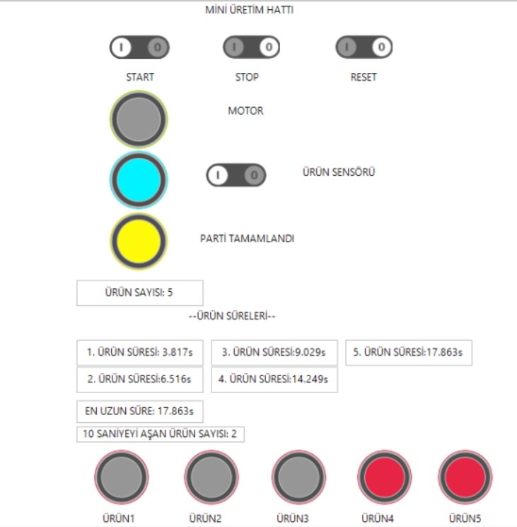

# Mini Üretim Hattı Parti & Döngü Süresi Takip Otomasyonu (CODESYS V3.5)

Bu proje; CODESYS V3.5 ortamında Structured Text (ST) dili ile geliştirilmiş bir mini üretim/dolum hattının parti kontrolünü, döngü sürelerinin dinamik dizi (ARRAY) analitiğini ve entegre HMI görselleştirmesini kapsamaktadır.

---

## 1. Sistem Mimarisi ve Kontrol Mantığı

Sistem, 5 adetlik ürün partileri halinde çalışacak şekilde kurgulanmıştır:

- **Motor & Hat Kontrolü:** Start/Stop butonları ve yükselen kenar (`R_TRIG`) lojiği ile konveyör hattının yönetimi.
- **Parti Takibi (CTU Sayıcı):** Sensör üzerinden geçen ürünlerin sayılması ve 5 ürün tamamlandığında hattın otomatik olarak durdurulup `parti_tamam` bayrağının set edilmesi.
- **Durum Yönetimi (State Machine):** `CASE` yapısı kullanılarak sistemin durumları (`bekliyor`, `uretim_devam`, `parti_tamam`) anlık olarak izlenmektedir.

---

## 2. Süre Analitiği ve Kalite Kontrolü (Diziler & Döngüler)

Sistemde temel I/O mantığının ötesinde veri işleme algoritmaları uygulanmıştır:

- **Döngü Sürelerinin Kaydı:** Her ürünün hattan geçiş süresi (`sayac.ET`), 5 elemanlı `ARRAY[0..4] OF TIME` dizisine dinamik olarak kaydedilmektedir.
- **En Uzun Süre Tespiti:** Üretim esnasında `FOR` döngüsü çalıştırılarak parti içindeki darboğaz oluşturan en uzun operasyon süresi (`en_uzun_sure`) filtrelenmektedir.
- **10 Saniye Eşik Kontrolü:** Süresi 10 saniyeyi aşan (`urun_sure > T#10S`) ürünler için ilgili istasyon alarm lambası tetiklenmekte ve tolerans dışı ürünlerin toplam adedi hesaplanmaktadır.

---
# Mini Üretim Hattı Parti & Döngü Süresi Takip Otomasyonu (CODESYS V3.5)

Bu proje; CODESYS V3.5 ortamında Structured Text (ST) dili ile geliştirilmiş bir mini üretim ve dolum hattının parti kontrolünü, döngü sürelerinin dinamik dizi (ARRAY) analitiğini ve entegre HMI görselleştirmesini kapsamaktadır.

---

## 1. Sistem Mimarisi ve Kontrol Mantığı

Sistem, 5 adetlik ürün partileri halinde çalışacak şekilde kurgulanmıştır:

- **Motor ve Hat Kontrolü:** Start/Stop butonları ve yükselen kenar (R_TRIG) lojiği ile konveyör hattının yönetimi.
- **Parti Takibi (CTU Sayıcı):** Sensör üzerinden geçen ürünlerin sayılması ve 5 ürün tamamlandığında hattın otomatik olarak durdurulup parti_tamam bayrağının set edilmesi.
- **Durum Yönetimi (State Machine):** CASE yapısı kullanılarak sistemin durumları (bekliyor, uretim_devam, parti_tamam) anlık olarak izlenmektedir.

---

## 2. Süre Analitiği ve Kalite Kontrolü (Diziler ve Döngüler)

Sistemde temel I/O mantığının ötesinde veri işleme algoritmaları uygulanmıştır:

- **Döngü Sürelerinin Kaydı:** Her ürünün hattan geçiş süresi (sayac.ET), 5 elemanlı ARRAY[0..4] OF TIME dizisine dinamik olarak kaydedilmektedir.
- **En Uzun Süre Tespiti:** Üretim esnasında FOR döngüsü çalıştırılarak parti içindeki en uzun operasyon süresi (en_uzun_sure) filtrelenmektedir.
- **10 Saniye Eşik Kontrolü:** Süresi 10 saniyeyi aşan ürünler için ilgili istasyon alarm lambası tetiklenmekte ve tolerans dışı ürünlerin toplam adedi hesaplanmaktadır.

---

## 3. Entegre HMI (Görselleştirme)

CODESYS Visualization arayüzü ile operatör paneli simüle edilmiştir:
- Sistem kumanda anahtarları (Start, Stop, Reset, Ürün Sensörü Simülasyonu)
- Ürün adedi ve parti durum lambaları
- Her ürünün milisaniye seviyesindeki çevrim süresi göstergeleri
- 10 saniyeyi aşan ürünler için görsel uyarı göstergeleri

Canlı simülasyon testi çıktısı:
- **Parti Sonu:** 5 ürün tamamlandığında sistem sarı renkli PARTİ TAMAMLANDI durumunu tetiklemiştir.
- **Süre Analizi:** Parti içindeki en uzun çevrim süresi (17.863s) tespit edilmiştir.
- **Kalite Eşik Kontrol**
